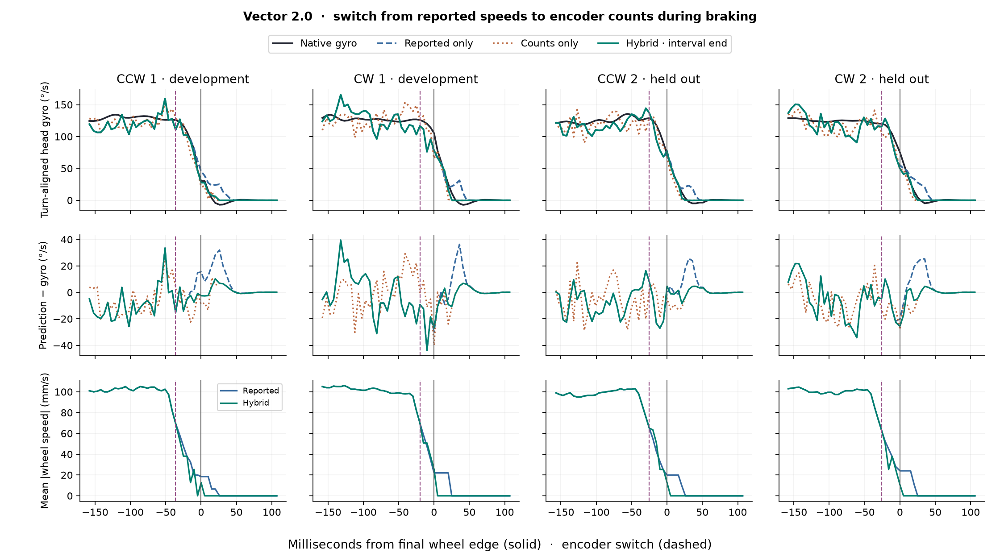
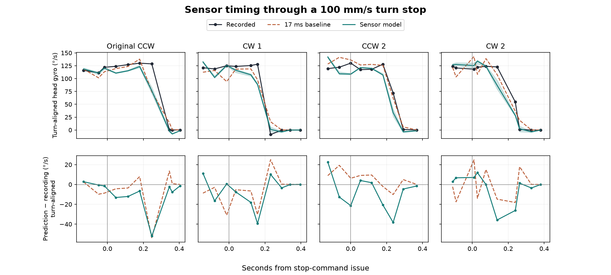
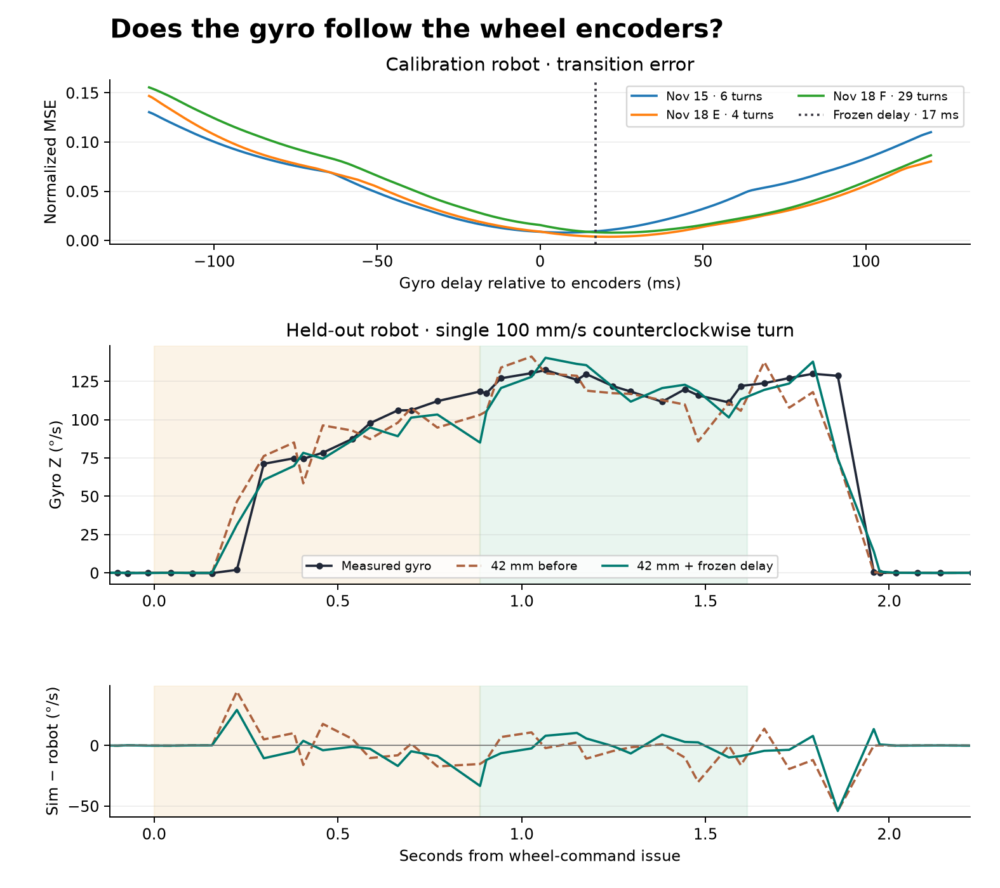
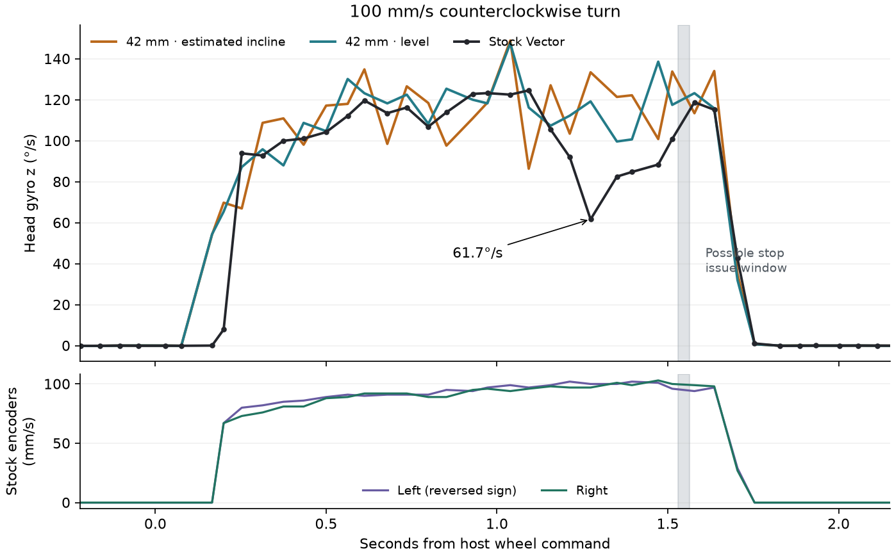
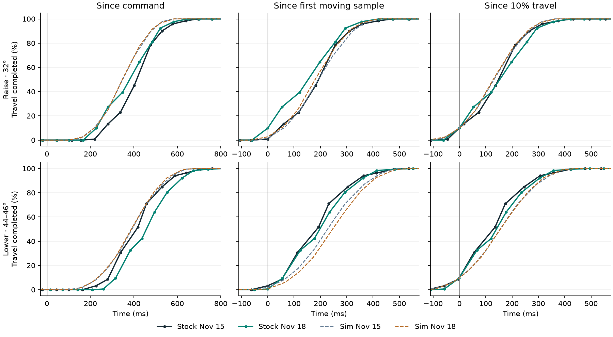

# Vector physics overlays

## Turning and tread contact

[Held-out hybrid results and one-frame switch sensitivity](../hw-rec-20261119/hybrid-replay.md)

[Held-out timing test and raw-count input comparison](../hw-rec-20261119/native-replay.md)

[Four Vector 2.0 stops on the robot clock](../hw-rec-20261119/native-stops.md)

[Firmware and SDK trace, phase assumptions, and held-out scores](../hw-rec-20261119/sensor-timing.md)

[Held-out braking scores and signed wheel and gyro traces](../hw-rec-20261119/repeated-braking.md)

[Timing methods, before/after scores and per-sample data](../hw-rec-20261119/unit2-ccw100.md#encoder-to-gyro-timing-test)

## Head and lift

[Head, lift, shell and tread findings](../stock-shell-physics-20261118.md)
