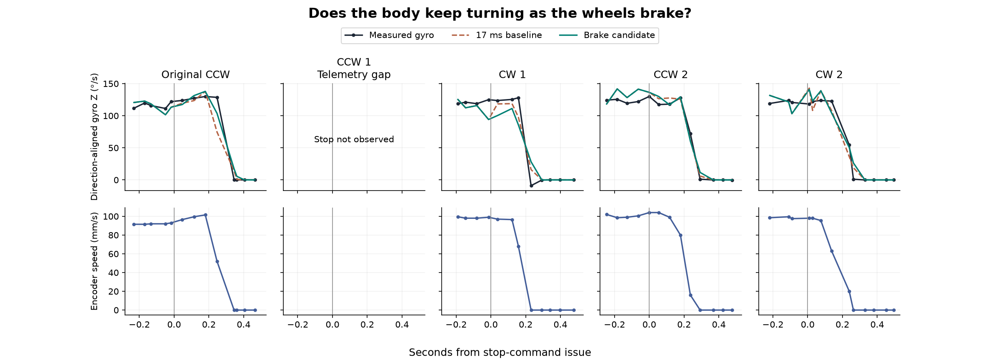
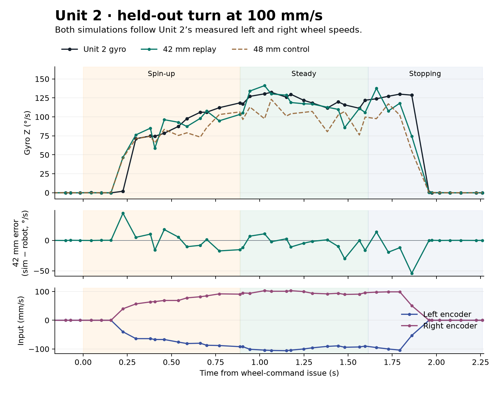
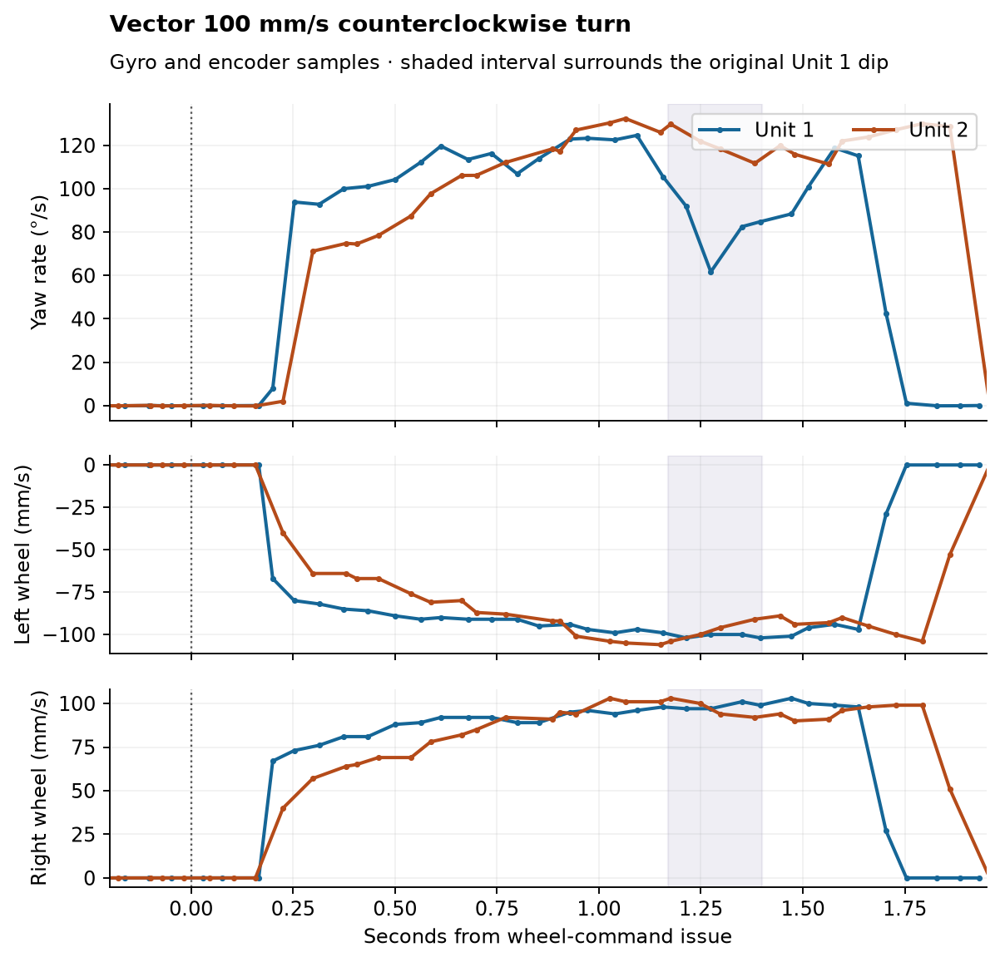
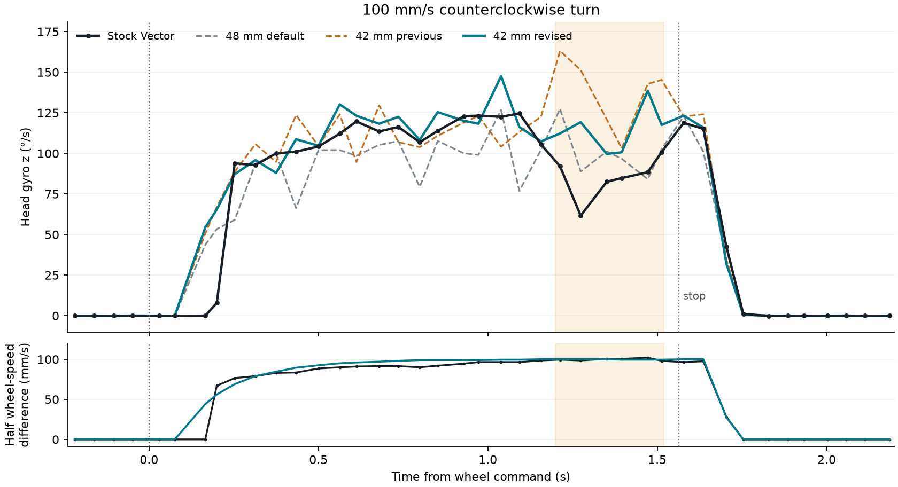
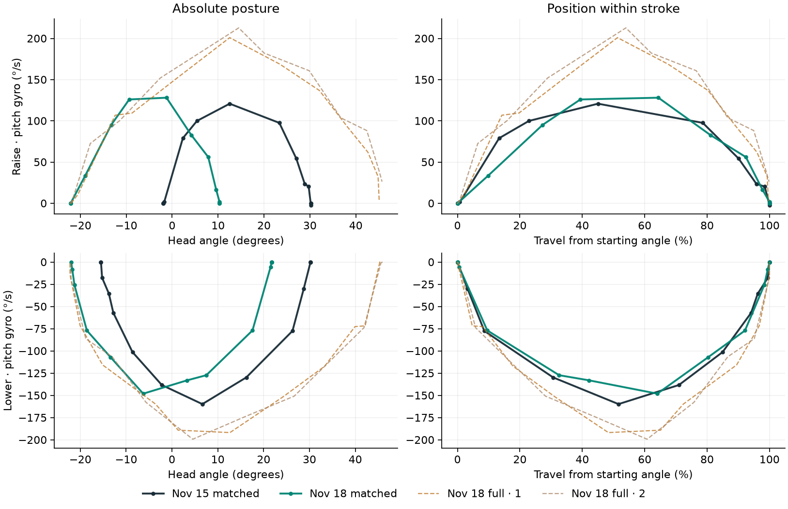
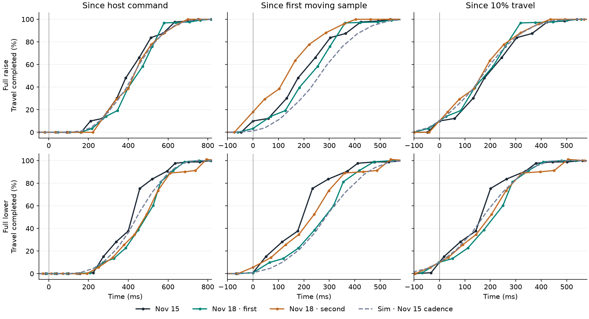
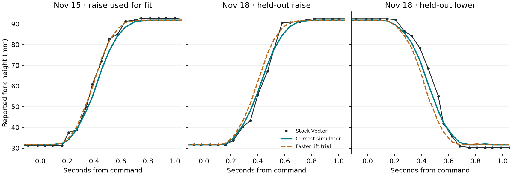

# Vector physics overlays

## Turning and tread contact

[Held-out braking scores and signed wheel and gyro traces](../hw-rec-20261119/repeated-braking.md)

[Timing methods, before/after scores and per-sample data](../hw-rec-20261119/unit2-ccw100.md#encoder-to-gyro-timing-test)

## Head and lift

[Head, lift, shell and tread findings](../stock-shell-physics-20261118.md)
